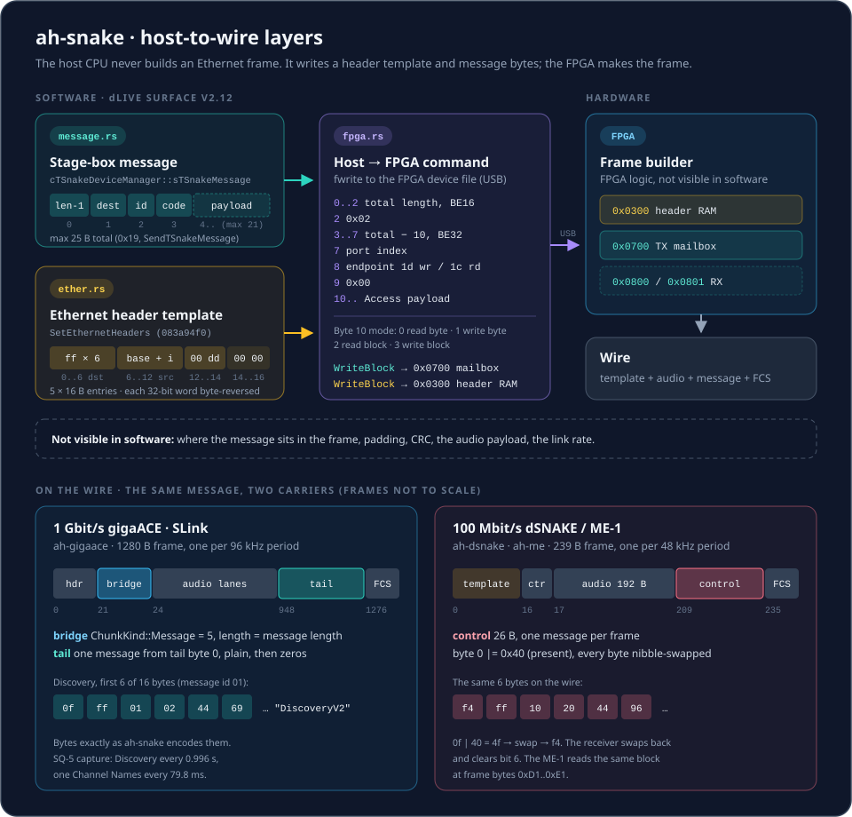
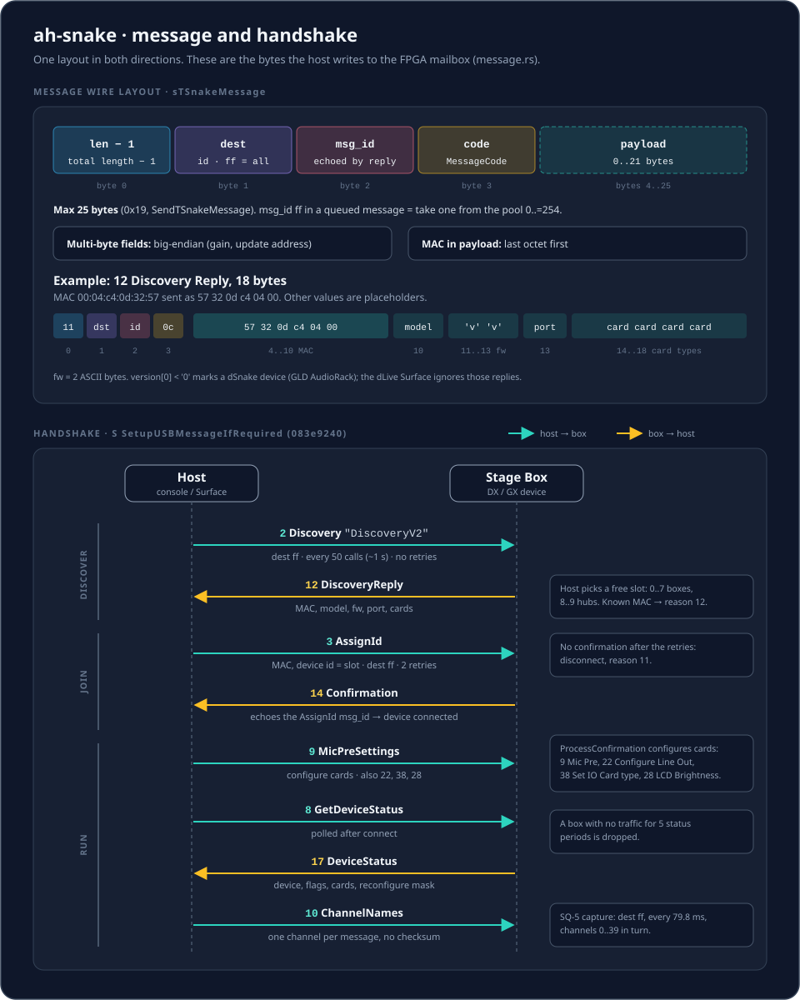

# ah-snake

Provenance: **disasm**. Recovered by disassembling stock firmware. The Discovery and Channel
Names messages were seen in a packet capture of a real SLink port and decode as this crate says;
nothing else was tested against a real unit. The `names` module is strings only.

Codec for the A&H stage-box control link: tSnake in dLive / Avantis code, dSnake in the
Qu / SQ UI. Plain codec, no I/O.

Evidence tags: **S** = dLive Surface V2.12 `TLDSurface` (x86), **M** = dLive MixRack V2.12
`TLDStageBox` (ARM), **Q** = Qu-5 V1.2.1 `01_Ru_Host.` (raw image at `0x100000`),
**A** = Avantis V2.02 `Console`. A code was read in the Ghidra clone `console_snake`, Q code in `quhost_snake`
(base `0x100000`). Addresses are in that binary. SQ-5 V1.6.3 (`01_sQu_Host.elf`) and SQ-5+
V2.0.3 (`01_sQu_Host`) are raw images at `0x100000` too; only their Discovery Reply handler and
model tables were read. Long-form notes:
`firmware/dlive/re/notes/snake.md` and `snake-bodies.md` (not tracked).

## Layers

<p align="center">
  
</p>

```
cTSnakeDeviceManager  --sTSnakeMessage-->  cTSnakeDriverBase  --fwrite-->  FPGA (USB)  --frame-->  wire
       message.rs                              fpga.rs                      ether.rs (template)
```

The host CPU never builds an Ethernet frame. It writes (1) a header template into FPGA
header RAM and (2) message bytes into an FPGA mailbox. The FPGA makes the frame.
**Not visible in software:** where the message bytes sit in the frame, padding, CRC, the
audio payload, and the link rate.

**Capture (SLink port at 1 Gbit/s, `ah-gigaace` README, "SLink capture"):** the port sends its
messages in the tail of the gigaACE frame, one message from tail byte 0, plain, with chunk kind 5
and the message length in the frame header. Discovery and Channel Names decode with this crate
byte for byte. For the 100 Mbit/s frame see `ah-dsnake`.

## Message (`message.rs`)

<p align="center">
  
</p>

| Byte | Field | Evidence |
|---|---|---|
| 0 | total length − 1 | S `FUN_083e51f0` writes `0x0f` for a 16-byte Discovery; every sender does the same |
| 1 | destination id, `0xff` = all | S senders: Discovery, Assign ID, Poke, Set MAC use `0xff`; others the device id |
| 2 | message id | S `SetupUSBMessageIfRequired` (`083e9240`): `0xff` → `TakeMessageID` (`083d53c0`); replies matched on this byte in `FUN_083e8560` |
| 3 | code | see below |
| 4.. | payload, ≤ 21 bytes | S `SendTSnakeMessage` (`083d6530`) caps the message at `0x19` bytes |

Byte order of multi-byte fields: big-endian (gain share, update address). MAC addresses
in payloads go **last octet first** (S `ProcessDiscoveryReply` builds a u48 from bytes 4..10
little-endian; `FUN_083d5900` prints its top byte first).

### Codes — proven: code = table index

- S `FUN_083d5c30`: name = `0x09b62de0 + 32 * code` for `code ≤ 0x29`, else `"Invalid Command"`.
- S receive dispatcher in `FUN_083e8560` (jump table `0x09b5f1b8`, index `code − 12`):
  12 → `ProcessDiscoveryReply` (`083e5db0`), 14 → `ProcessConfirmation` (`083e7f80`),
  17 → `FUN_083e8210`, 26 → `FUN_083d6b50`, 29 → `FUN_083e5c50`, 31..37 → share handlers.
  M `FUN_0010b808` is the same switch, as a clean `switch`: cases 13, 15, 16, 18..=25, 27, 28
  and 30 are empty, codes above 37 fall through.
- A `FUN_004d8fb0` is the same lookup (`0x024512e0 + 32 * code` for `code < 0x2d`), so
  41..=43 (`ME …`) are proven names at those indices; 44 is `"Invalid command"`. dLive index
  41 is the `"Invalid command"` label.
- A receive switch `FUN_004e0840` drops codes above 29 and handles 2 (`FUN_004d8e00`, checks
  `"DiscoveryV2"`), 12, 14, 17, 26 (`FUN_004d8d30`), 29 (`FUN_004dd800`). No share codes.
- Q receive switch in `FUN_00110e28` handles 2, 12, 14, 17, 26, 29.

### Typed bodies (`Body`)

Every code that S, M, A or Q builds or parses has a body. Mic pre payloads are in
`micpre.rs`. "Unset" bytes are bytes the stock builder never writes (stack garbage on the
wire); the crate encodes them as 0 and ignores them on decode.

| Code | Body | Payload | Evidence |
|---|---|---|---|
| 2 Discovery | `Discovery` | `"DiscoveryV2\0"` | S `FUN_083e51f0`; string also in Q |
| 12 Discovery Reply | `DiscoveryReply` | MAC(6), model, version(2 ASCII), port, cards(4) | S `ProcessDiscoveryReply` |
| 3 Assign ID | `AssignId` | MAC(6), device id | S `FUN_083e53a0`, called from `ProcessDiscoveryReply` |
| 14 Confirmation | `Confirmation` | source (`0xff` from host), confirmed code, 1 unset byte | S `FUN_083e48a0` (host form). Device form: **inferred** same |
| 1 Soft Reset, 5 Enter Update Mode, 39 Enter Update Mode 48k | unit | 1 unset byte (A Soft Reset: 7) | S `FUN_083e5850`, `FUN_083e54a0`; A `FUN_004dca10`, `FUN_004dc6a0` (code `0x27` when its flag argument is set, else 5); Q `FUN_001130e8` (same choice); Q treats a confirmed 39 like 5 |
| 6 Update Data | `UpdateData` | last(0/1), `0x02`, address BE24, 16 data | S `FUN_083e55f0`; confirm handling in `ProcessConfirmation`; Q `FUN_00112d28` same |
| 7 Set Device Config | `SetDeviceConfig` | key, value | S `FUN_083e50e0` and M `FUN_00109c80` replace a queued 7 with the same device and key; A `FUN_004dc3f0`; Q `FUN_00112c00` sends keys 4, 5, `0x0c`, `0x24`, `0x27`, `0x30` to dSnake devices (meanings unknown) |
| 8 Get Device Status | unit | none | S `FUN_083e8c80`, A `FUN_004def20`, Q `FUN_00112c9c` |
| 9 Mic Pre Settings | `MicPreSettings(MicPre)` | 8-ch (11 bytes) or 12-ch (17 bytes) form, below | S `AddMicPreMessage` (`083e6f80`), M `00108ee8`, Q `FUN_00111834` |
| 9 (dSnake) | `micpre::DSnakeMicPre` (not in `Body`) | card, 8 × BE16 gain | Q `FUN_00112a84`, A `FUN_004de090` |
| 10 Channel Names | `ChannelName` | channel, name(7), 0, stereo link, source kind, source number | S `FUN_0827a3b0` fed by `FUN_0827a8f0`; Q `FUN_00110e28` + `FUN_001108ec` |
| 16 Device Poke | unit | none | S `FUN_083e5300`, A `FUN_004dc590` |
| 17 Device Status Message | `DeviceStatus` | device, ?, flags, cards(4), reconfigure mask, 2 bytes | S `FUN_083e8210` (fields named by use only); Q case 17 reads the same offsets |
| 19 Set MAC Address | `SetMacAddress` | `00 02 07 f0 00`, MAC(6) | S `FUN_083e6800`, A `FUN_004dda10`. That the prefix is "address `0x07f000`" is **inferred** |
| 20 Set SRC Bypass | `SetSrcBypass` | card, bit per pair | S `FUN_083e7740` (length byte 9: 4 unset bytes), M `ConfigureNewCard` (`00109e94`), Q `FUN_00112068` (length byte 5). "Set = bypass" is **inferred** from the name |
| 21 Set Digital Output rate | `SetDigitalOutputRate` | card, 2-bit code per pair, 2 one-hot bytes, mask, mode (dLive only) | S `FUN_083e7940`, M `FUN_00108ccc`, Q `FUN_001121f8` (no mode byte). Rate code meanings unknown |
| 22 Configure Line Out | `ConfigureLineOut` | card | S `FUN_083e4f40` (card types 2, 6, 19, 20), M `FUN_00109dcc`, A `FUN_004dc280`, Q `FUN_001124bc` |
| 23 Deluxe Mic Pre Settings | `DeluxeMicPreSettings` | card, 8 × (dB / 3, `0x30` \| flags \| step) | S `AddMicPreMessage` (card type 7), Q `FUN_00111834` |
| 26 DX Hub Status | `DxHubStatus` | device, ?, flags, 5 ?, port bits | S `FUN_083d6b50`, A `FUN_004d8d30`, Q case 26 (device to host; sender length unknown) |
| 27 LCD Data | `LcdData` | 2 bytes, 8 + 8 bytes, 2 bytes | S `FUN_0821a090`, M `FUN_002c2500`, A `FUN_004df170`. Caller not traced; "two text lines" **inferred** |
| 28 LCD Brightness | `LcdBrightness` | 2 bytes | S `FUN_083e6910`, M `FUN_00109600`: only `ff 60`, to model class 7. Meaning unknown |
| 29 Get GX Status | `GxStatus` | device, ?, flags, 10 ?, port bits | S `FUN_083e5c50`, A `FUN_004dd800`, Q case 29 (device to host) |
| 31, 32 Gain share | `GainShare` | channel, gain BE16 | S send `FUN_083e8d20`/`FUN_083e8e90`, receive `FUN_083e49f0`/`FUN_083e4ac0` |
| 33..37 Has mic pre / Pad / PP share | `FlagShare` | channel, value | S `FUN_083e8dd0`..`FUN_083e9180`, `FUN_083e4a50`.. |
| 38 Set IO Card type | `SetIoCardType` | 0 / 1 | S `FUN_083e5040` from `FUN_083e7d90` (1 for first card type 13, 15, 16, 17), M `FUN_00109d5c`, A `FUN_004dc370`, Q `FUN_001117a4` (same rule) |

#### Mic pre (`micpre.rs`)

The message does not say which form it is: the host picks it by card. S `AddMicPreMessage`
switches on the device-model class (`DeviceModel::kind`, record `0x24`): classes 0..=3, 5..=7,
9..=11 → 8-channel form, class 4 (GX-4816) → 12-channel form, card type 7 → deluxe (code 23).
Q builds every tSnake form byte for byte the same.

| Form | Payload (payload index: content) | Slot `s` is channel |
|---|---|---|
| 8-ch | 0 card, 1-2 g0 g1, 3 F(s3,s2,s1,s0), 4-7 g2..g5, 8 F(s7..s4), 9-10 g6 g7 | `first + 7 − s`; class 9 (DX-88): `first + s` |
| 12-ch | 0 card, 1 F(s1,s0,s11,s11), 2-5 g0..g3, 6 F(s5..s2), 7-8 g4 g5, 9 F(s7,s6,s11,s11), 10-13 g6..g9, 14 F(s11..s8), 15-16 g10 g11 | `first + 11 − s` |
| deluxe | 0 card, then per slot: `dB / 3`, `0x30 \| a << 3 \| b << 2 \| (3 − dB % 3)` | `(first \| 7) − s` |
| dSnake | 0 card, then per slot BE16 gain | `(first \| 7) − s` |

`F(w, x, y, z)` holds the flag pairs of slots w, x, y, z at bits 0-1, 2-3, 4-5, 6-7; in each
pair bit 0 is flag a (S driver field `0x19a`, Q `+0xcd`) and bit 1 flag b (S `0x21a`, Q
`+0xcc`) (S `FUN_083d6470`). Card = port offset in the device / channels per card.
Gain codes (8/12-ch) come from a table S fills at run time (`0x0aa96760`, indexed by whole
dB in `08279f10`): **unknown** map. Deluxe dB is the high byte of the 16-bit gain, clamped
to 0..=60 dB by S `08279f10`. **Inferred:** flag a = pad, flag b = 48 V. S stores gain,
flag a, flag b as three 128-entry arrays (`0x9a`, `0x19a`, `0x21a`), and its share manager
stores gain, pad, PP in the same order (`0xb8`, `0x1b8` set by `FUN_0854bd90` for code 34,
`0x238` by `FUN_0854c140` for code 36). No code names the two driver arrays.

Q builds messages with the same byte layout (struct offsets `+0x18` = byte 0, `+0x19`
dest, `+0x1a` id, `+0x1b` code) and the same codes.

### Codes nobody uses

Builders were enumerated as every caller of the queue functions (S `083e4ce0`, `083e6a60`,
plus the confirmation path `083e48a0`; M `00108098`, `00108254`; A `004dbfd0`, `004ddb50`;
Q `FUN_00111714`), and every receive switch above was read.

- **Not built or parsed by S, M, A or Q:** 0, 4, 11, 13, 15, 18, 24, 25, 30, 40, 41, 42, 43.
  S `FUN_083e69c0` and A `FUN_004ddad0` send a 1-byte `00` (length byte 0, no code byte)
  from `SetupUSBMessageIfRequired`; that is not a code-0 message.
- 39 is used (A, Q; see the table). The old list that called it unused was wrong.
- **ME codes 41..=43:** names only. No Avantis builder writes them and the Avantis receive
  switch drops them, so no layout is known. The ME link may use another path that was not
  found.
- **Channel Names Checksum (18):** no build computes or checks it, so its algorithm is
  **unknown**. Channel names (code 10) go out one channel per message with no checksum.

### Handshake and timing (S `SetupUSBMessageIfRequired`, `083e9240`)

1. Every 50 calls, while no update runs, the host broadcasts Discovery (no retries).
2. A device answers Discovery Reply. The host picks a free slot (0..7 for boxes, 8..9 for
   hubs: model `kind` 3 or 4), rejects a MAC already known (disconnect reason 12), and
   sends Assign ID with that slot as the device id (2 retries).
3. The device confirms (code 14, echoing the Assign ID message id). `ProcessConfirmation`
   marks the device connected and configures its cards (Mic Pre, Configure Line Out,
   Set IO Card type, LCD Brightness).
4. The host then polls Get Device Status; replies are code 17.

Messages that expect a reply wait in a list. Each call adds 20 to their age. At the
timeout (default 400; Assign ID 400 with 2 retries; Update Data 800; Enter Update Mode
30000) the host resends, up to the retry count (default 7). An Assign ID that runs out
disconnects with reason 11. The timeout gets `((id % 5) * 5 − 5) * 4` added. A device with
no traffic for 5 status periods is dropped. **Inferred:** the units are ms (one call per
20 ms); the call period is not in this code. The SLink capture agrees: Discovery every 0.996 s
(50 calls) and one Channel Names message every 79.8 ms on average (the Surface's every 4th call),
channels 0..39 in turn. The capture is from an SQ-5: its message ids count up like the
Surface's pool, and its Channel Names rate is the Surface's, not the Qu-5's once a second. Message ids 0..=254 form a FIFO pool
(`FUN_083e3d90` fills it, `FUN_083d54a0` returns ids).

Q differs: the message id is a counter 0..=254 that wraps (field `0x8d5a`), timeouts are
400000 / 500000 / 2000000 with 5 retries. 400000 against S's 400 supports the ms reading.

## FPGA command (`fpga.rs`)

Written with `fwrite` to the FPGA device file (`cUSBManager` driver). Layout and every
constant: see the module doc. Evidence: S `SendTSnakeMessage`, `ReadTSnakeMessage`,
`CheckForNewMessage`, `ReadLocalStatus`, `ResetTSnakeRx`/`Tx`; same bytes in M.

| Item | Value | Evidence |
|---|---|---|
| Endpoint byte 8 | `0x1d` write, `0x1c` read, `0x15` prog-reg | all writers |
| Access mode byte 10 | 0 read byte, 1 write byte, 2 read block, 3 write block | all register writers |
| tSnake TX mailbox | `0x0700` | S `FUN_083d92d0` (driver field `0x4dc`) |
| tSnake RX status / message | `0x0800` / `0x0801` | same (field `0x4de`), `ReadTSnakeMessage` reads at `+1` |
| RX status byte | 0 empty, `0xff` flag, n = message of n+1 bytes waiting | S `FUN_083e8560` |
| Reset RX / TX | write `1` to `0x0203` / `0x0106` | S `083d6290`, `083d6380` |
| Read reply | 4 bytes (meaning unknown), then data | S `FUN_083e8980`, `FUN_083e8560` |

The names "read/write byte/block" for modes 0..3 are **inferred** from how each mode is used.

## Ethernet header (`ether.rs`)

S `cTSnakeDriver::SetEthernetHeaders` (`083a94f0`, same in M `00102bec`): five 16-byte
entries at FPGA address `0x0300`. Word order: bytes of each 32-bit word reversed
(**inferred**, from the gigaACE preamble, see `ah-gigaace`). After the swap each entry is:

| Bytes | Value | Evidence |
|---|---|---|
| 0..6 | destination `ff:ff:ff:ff:ff:ff` | S constructor `FUN_083d9450` sets field `0x520` |
| 6..12 | source `base + i`, i = 0..4 (some 0, by two constructor flags) | `FUN_083d9450` fields `0x4f8 + 8i` |
| 12..14 | `0x00dd` | constant in `SetEthernetHeaders` |
| 14..16 | 0 | same |

`0x00dd` is below `0x0600`, so as IEEE 802.3 it would be a length (221), not an EtherType.
**Unknown:** which entry is used for which port.

### The field is most likely an 802.3 length (inferred)

One frame per 48 kHz sample period on 100 Mbit/s leaves room for at most 222 payload bytes
(`100e6 / (48000 * 8) = 260.4` bytes of wire time, minus 8 preamble, 14 header, 4 FCS and 12
inter-frame gap). `0x00dd` is 221, one byte under that limit: 99.456 Mbit/s. The gigaACE
template (`ah-gigaace`) has `0x04ee` = 1262: one frame per 96 kHz sample period on 1 Gbit/s
leaves at most 1264 payload bytes (998.4 Mbit/s). Both values sit within 2 bytes of the largest
payload that fits, which a chance value would not. Read as lengths, they say the FPGA sends one
full-rate frame per sample period (48 kHz tSnake, 96 kHz gigaACE). This is arithmetic on proven
constants, not something read in the firmware: the frame builder is FPGA logic.

For the Qu-5 this is now measured (`ah-dsnake`, simulation of its FPGA image): one frame per
48 kHz period with 221 payload bytes, so 221 is the payload length. The Qu template puts `0xdd`
in its last byte, and the FPGA sends template words byte-reversed, so the wire carries `dd 00`
at bytes 12..14. The dLive template layout above was not simulated.

### The ME port carries the same message format (inferred)

The control block of an ME port frame in `ah-me` (bytes `0xD1..0xE1`, recovered from the
ME-1's own receive code) equals a tSnake `Channel Names` message byte for byte, except for the
first byte, which is the ME-1's 'present' status `0x40` where the tSnake message has its length:

| ME frame | tSnake message | Field |
|---|---|---|
| `0xD2` = `0xFF` | byte 1 | destination, `0xFF` = all |
| `0xD3` | byte 2 | message id. The simulator sends 0; the Avantis builder stores `0xFF` (`FUN_004defa0` starts the message with the word `0x0aFFFF0F`). Whether the send queue rewrites it for this broadcast code was not checked |
| `0xD4` = 10 | byte 3 | message code 10, Channel Names |
| `0xD5` | byte 4 | channel |
| `0xD6..0xDE` | bytes 5..13 | name, 8 bytes (the Qu sends 8 name bytes, the Surface 7 and a 0) |
| `0xDE` | byte 13 | stereo link |
| `0xDF`, `0xE0` | bytes 14, 15 | source kind, source number (`ah-me` calls them `unknown_1`, `unknown_2`). **Proven for the sender**: the Avantis builder `FUN_004defa0` writes the stereo link, kind and number to bytes 13, 14, 15, fed by the tick `FUN_004df040` (see `ah-ahnet-avantis`); that they sit at `0xDF` / `0xE0` in the ME frame follows from the alignment above |

`tests/me_link.rs` pins this. The audio block of the ME frame is 8 rows of 24 bytes: 64 slots
of 24 bits, of which the ME-1 reads 40. With the 3 header bytes before it and the 16-byte
control block after it, the ME-1's fixed offsets add up to 195 + 16 = 211 of the 221 payload
bytes; the last 10 are unread by the ME-1. So `ah-me`'s `Frame` is very likely the tSnake /
ME frame, but `ah-me` pads it to 240 bytes, which the arithmetic above rules out as the real
on-wire size. Whether the DX stage boxes and the dSnake links use this same audio layout is
**unknown**: only the ME-1 receiver was available.

The source kind values: both consoles map their own source types onto one kind enum. The
Surface table at `0x09232de0` (bytes) and the Avantis table at `0x01a8fea0` (32-bit entries)
agree on the tail (kind = type - 4 for Surface types from 10, type - 1 for Avantis types from 7;
kinds 6 up to `0x1d`), and both send kind 2 for the console's own local I/O and 24 for FX
returns. Neither build sends `0x1e` or 5: `0x1e` is the ME-1's own 'unset' default, not
something a mixer sends. The names of the kinds ("Surf", "Dsnk", "Main", "PAFL", "Grp", "Aux",
"Bus" appear in the ME-1 firmware) are still not mapped to the numbers.

## Tables (`tables.rs`)

| Table | Values | Evidence |
|---|---|---|
| `DLIVE_DEVICE_MODELS` | 21 records with the wire code | S 40-byte records at `0x09b63600`, searched by `ProcessDiscoveryReply` |
| `CARD_TYPES` | index = card code, 0..31 | S `FUN_083d5cf0` (proven) |
| `QU_CARD_TYPES` | Qu record index | Q 34-byte records at `0x210e0c`; index = code **inferred** (matches dLive codes) |
| `DISCONNECT_REASONS` | index = `eDisconnectReason` | S `FUN_083d5d50` (proven) |
| `QU_TSNAKE_MODELS`, `QU_DSNAKE_MODELS` | index = model code | Q `FUN_00110e28` prints `table + code * 0x26` (proven) |
| `SQ5_TSNAKE_MODELS` | index = model code | SQ-5 V1.6.3 `FUN_001141e0` prints `0x831f3c + code * 0x26` (proven) |
| `SQ5P_TSNAKE_MODELS` | index = model code | SQ-5+ V2.0.3 `FUN_00113544` uses `0xca2440 + code * 0x26` (proven) |

Q's tSnake codes match S except DX84: Q `0x74` `DX84`, S `0x5c` `DX-84`; Q also has
`0x60` `GX2412` and `0x70` `DX168R`, S has `0x68` `DX-USB`.

The SQ images split the same way: SQ-5 V1.6.3 numbers `DX84` as `0x5c` (like S) and has no
`DX-USB`; SQ-5+ V2.0.3 numbers `DX84` as `0x74` (like Q) and adds `DX-USB` at `0x68` (like S).
The expected-firmware bytes of `GX4816`, `GX4816 Type 2`, `GX2412`, `DX168R` and `DX84` differ
between the three images. A table is per firmware build, so a host must pick it by build, not
assume one model-code table for all A&H mixers. The dSnake table is byte for byte the same
in Q, SQ-5 (`0x8334cc`) and SQ-5+ (`0x877154`).

Device-model record bytes `0x21..0x24` (slots, inputs, outputs) are **inferred** from the
names (DX-1608: 2, 16, 8; GX-4816: 4, 48, 16).

## tSnake vs dSnake

Same message layer. The difference Q shows (`FUN_00110e28`, Discovery Reply case):

- Version byte 0 `>= '0'` (ASCII version): tSnake. Logged `tS: Discovery reply for %s`,
  name from the DX/GX table at `0x6d0d20` (`QU_TSNAKE_MODELS`), version logged `v.%c %c`.
- Version byte 0 `< '0'` (binary version): dSnake. Logged `dS: Discovery reply for %s `,
  name from the GLD AudioRack table at `0x2112d0` (`QU_DSNAKE_MODELS`, codes 0..4 and
  `0x10..0x12`), version logged `v.0x%02x 0x%02x`. Only codes 0, 1, 2, `0x10..0x12` are taken.
- Both then get the same Assign ID message.

SQ-5 V1.6.3 (`FUN_001141e0`) and SQ-5+ V2.0.3 (`FUN_00113544`) have the same handler: a switch
on message byte 3 (`case 2` Discovery, `case 0xc` Discovery Reply), the model code at message
byte 10, the version at bytes 11 and 12, the same `< '0'` family test, the same `tS:` / `dS:`
log texts and the same 38-byte table records. Proven by decompiling both. The message layer
is therefore the same in Qu-5, SQ-5 and SQ-5+. The other message handlers of the SQ images were
not compared one by one.

S ignores replies with version byte 0 `<= 0x2f`, so dLive accepts tSnake devices only.
`DiscoveryReply::family()` encodes this rule. **Unknown:** whether dSnake devices differ on
the wire below the message layer (FPGA framing); Q's FPGA driver was not read.

## Tests

`tests/vectors.rs`: hand-written byte vectors for Discovery through the mailbox, the
handshake messages, the mic pre forms, card configuration, status and other bodies, FPGA register commands, the header template, the
code table and decoder errors. Each test names the stock function its bytes come from.
