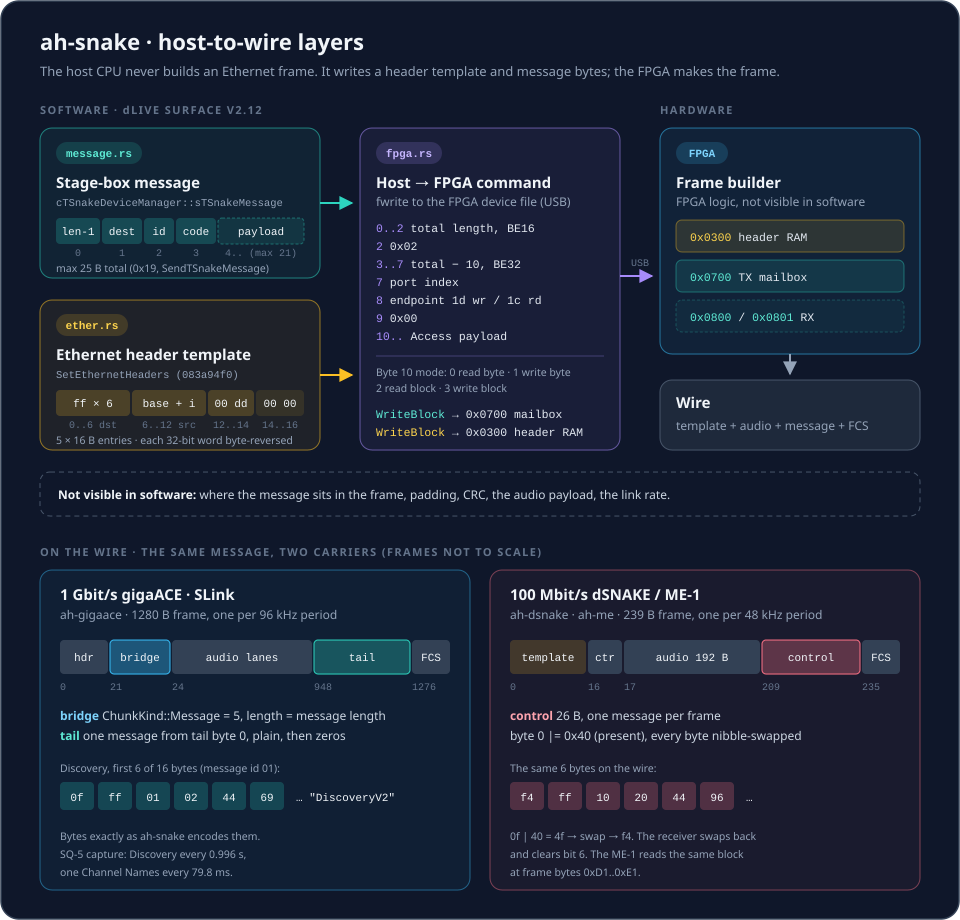
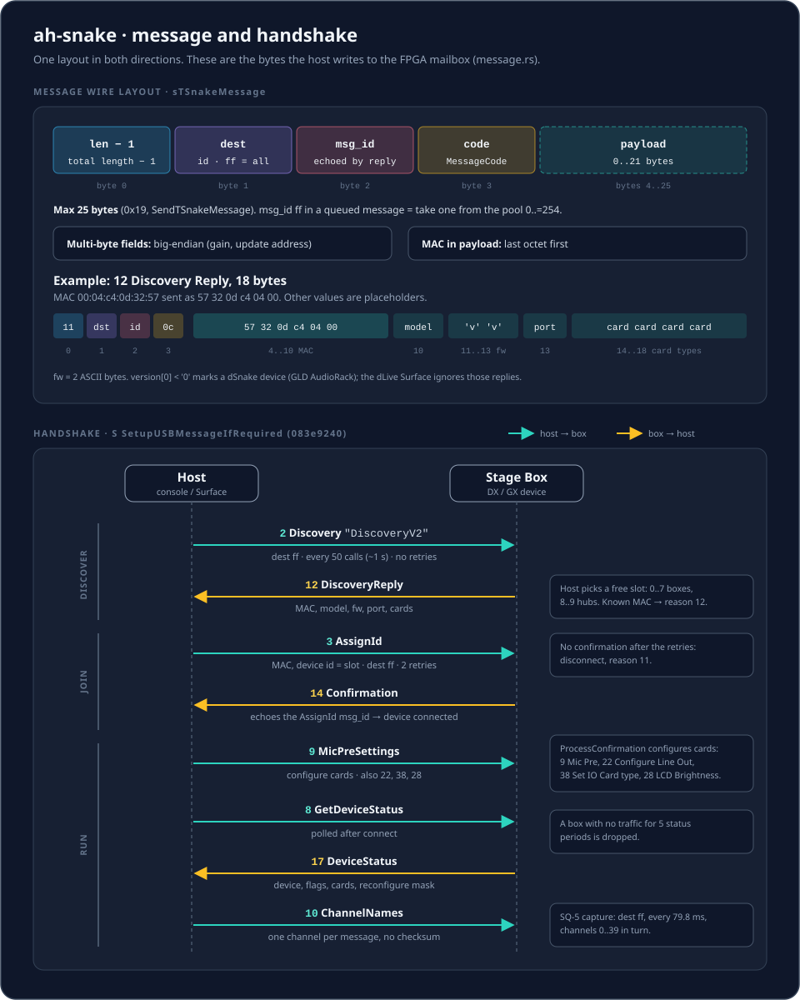

# ah-snake

A Rust library for encoding and decoding Allen & Heath stage-box control messages (dSnake, tSnake, and SLink expanders on dLive, Avantis, SQ, and Qu consoles).

`ah-snake` is a pure codec with no network or audio I/O: you pass in raw message bytes and get typed Rust structs back, or encode messages ready to send over a 1 Gbit/s gigaACE link ([`ah-gigaace`](https://github.com/JudahZF/ah-gigaace)) or a 100 Mbit/s dSnake/tSnake link.

## What it covers

- **Stage-box discovery and handshake:** Discovery (`DiscoveryV2`), Discovery Reply, Assign ID, Confirmation, and device status polling.
- **Audio I/O control:** mic preamp settings (gain, pad, 48 V), channel names, SRC bypass, digital output rates, and LCD updates.
- **Hardware lookup tables:** device model IDs (GX4816, DX168, DX164-W, AR2412, AB168, and others), I/O card codes, and disconnect reasons.
- **Host-to-FPGA framing:** mailbox commands and Ethernet header templates shared with `ah-gigaace`.

## How it fits on the wire

<p align="center">
  
</p>

## Message format and handshake

<p align="center">
  
</p>

## Quick start

Add `ah-snake` to your `Cargo.toml`:

```toml
[dependencies]
ah-snake = { git = "https://github.com/JudahZF/ah-snake" }
```

Encode and decode a message:

```rust
use ah_snake::{Body, Message};
use ah_snake::message::BROADCAST;

// Build a stage-box Discovery message
let bytes = Message::from_body(BROADCAST, 1, &Body::Discovery).encode();

// Decode incoming message bytes (for example from a gigaACE tail)
let msg = Message::decode(&bytes)?;
if let Ok(Body::Discovery) = Body::from_message(&msg) {
    println!("received stage-box discovery (id {})", msg.id);
}
```

## Status

Discovery and Channel Names messages have been verified against live 1 Gbit/s SLink captures from an SQ-5. Other message types (preamp control, status replies, card config) are implemented and unit-tested (`cargo test`), but have not yet been verified against physical stage boxes.

## Technical reference

Full byte tables, message codes, FPGA mailbox framing, and firmware notes live in [PROTOCOL.md](./PROTOCOL.md).

## License

Licensed under the GNU General Public License v2.0 or later ([LICENSE](./LICENSE)).
